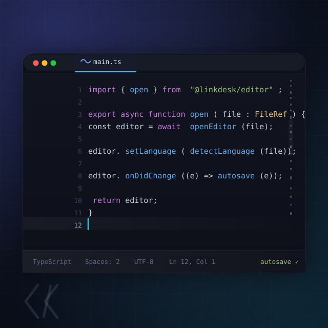

# Editor

Monaco code editor — syntax highlighting, IntelliSense, and diff view



## What it does

- 1 commands, available from the Command Palette and the Plugin Store's Features tab.
- 26 settings, editable in Settings.

## Commands

| Command | What it does |
|:--|:--|
| `editor.forceOpenAsText` — Open with this editor anyway | Force-open a binary file from the "cannot be displayed as text" screen as text: garbled characters are shown as-is and editable, with one confirmation before saving (saving overwrites the original file with the text content). The optional { filePath } argument targets a specific tab; omit it when exactly one such tab exists—if several do, filePath is required. |

## Settings

- **Auto Save** (`editor.autoSave`) — Auto Save — off / afterDelay (after 1s idle) / onFocusChange (on tab switch)
- **Font Size** (`editor.fontSize`) — Editor font size
- **Font Family** (`editor.fontFamily`) — Editor font family
- **Font Weight** (`editor.fontWeight`) — Editor font weight
- **Line Height** (`editor.lineHeight`) — Line height — 0 for auto calculation
- **Tab Size** (`editor.tabSize`) — Tab indent size (spaces)
- **Insert Spaces** (`editor.insertSpaces`) — Insert spaces instead of tabs
- **Detect Indentation** (`editor.detectIndentation`) — Auto-detect file indentation settings
- **Word Wrap** (`editor.wordWrap`) — Word wrap mode
- **Line Numbers** (`editor.lineNumbers`) — Line numbers
- **Minimap** (`editor.minimap.enabled`) — Show minimap
- **Whitespace** (`editor.renderWhitespace`) — Render whitespace
- **Smooth scrolling** (`editor.smoothScrolling`) — Smooth scrolling
- **Cursor style** (`editor.cursorStyle`) — Cursor style
- **Cursor Blinking** (`editor.cursorBlinking`) — Cursor blinking style
- **Mouse Wheel Zoom** (`editor.mouseWheelZoom`) — Ctrl+Scroll to zoom font size
- **Auto-closing brackets** (`editor.autoClosingBrackets`) — Auto-closing brackets
- **Bracket Colorization** (`editor.bracketPairColorization`) — Bracket pair colorization
- **Indentation guides** (`editor.guides.indentation`) — Indentation guides
- **Linked Editing** (`editor.linkedEditing`) — Linked editing — HTML/XML tag sync rename
- **Occurrences Highlight** (`editor.occurrencesHighlight`) — Highlight all occurrences of selected word
- **Selection Highlight** (`editor.selectionHighlight`) — Highlight text matching selection
- **Parameter Hints** (`editor.parameterHints.enabled`) — Function parameter hints
- **Quick suggestions** (`editor.quickSuggestions`) — Quick suggestions
- **Word Suggestions** (`editor.suggest.showWords`) — Show word suggestions in completion list
- **Snippet Suggestions** (`editor.suggest.showSnippets`) — Show snippet suggestions in completion list

## Install

Open the Plugin Store, find this plugin, and click Install. For offline use, install the `.linkdesk-plugin` package from disk.

## Development

```bash
npm install
npm run dev      # preview in the dev host
npm run lint     # eslint + manifest i18n completeness
npm run verify   # full repository gate
npm run build    # produce the .linkdesk-plugin package
npm run publish  # GitHub Release + catalog entry
```

See the repository root `README.md` for the Chinese documentation and the full directory contract.
